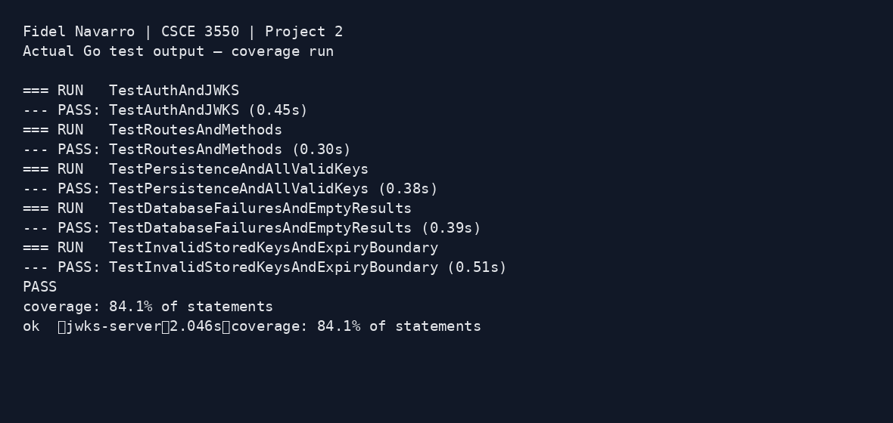

# JWKS Server — Project 2
Fidel Navarro | CSCE 3550

Go JWKS server with persistent SQLite storage and parameterized SQL queries.
Authentication is mocked for userABC; this project does not validate passwords.
Both HTTP Basic auth and JSON credential requests can receive a JWT.

## Run
Requires Go 1.23.2 or newer. The SQLite driver is pure Go; no separate SQLite
installation or C compiler is needed.

```sh
go mod download
go run .
```
Run from the repository root. The server listens on port 8080 and creates
`totally_not_my_privateKeys.db` in the current directory with this schema:

```sql
CREATE TABLE IF NOT EXISTS keys (
    kid INTEGER PRIMARY KEY AUTOINCREMENT,
    key BLOB NOT NULL,
    exp INTEGER NOT NULL
);
```

Private keys are saved as PKCS1 PEM bytes. Existing keys survive restarts.
Startup creates a key expiring in one hour if no valid key remains, and an
expired key if none exists. The database ID becomes the JWT/JWK `kid` string.
SQL values use `?` placeholders; request text is never concatenated into SQL.
The database contains private keys and is intentionally excluded from Git.

- `POST /auth`: read a valid private key from SQLite and return an RS256 JWT.
- `POST /auth?expired=true`: read an expired key and return an expired JWT.
  Any presence of `expired`, including `?expired=false`, selects expired keys.
- `GET /.well-known/jwks.json`: read all unexpired keys and return only their
  public RSA values. Keys whose expiration equals the current time are expired.

If no signing key is available, auth returns 500. Restart the server to seed a
new valid key after all saved keys expire. Automatic background rotation is not
implemented.

## Tests and lint
```sh
gofmt -w *.go
go vet ./...
go test -v -coverprofile=coverage.out ./...
go tool cover -func=coverage.out
```
Measured coverage: **84.1%**. Tests check signatures, both credential formats,
expired parameters, all valid public keys, persistence, unique IDs, expiration
boundaries, parameterized inserts, invalid stored keys, and database failures.


The image captures the actual saved test output rendered for readability;
its unmodified text is in `screenshots/test-output.txt`.

## Gradebot and submission
Download the test client from https://github.com/jh125486/CSCE3550/releases.
In Windows PowerShell, from the repository root, with no server already running:

```powershell
Write-Output "Fidel Navarro | CSCE 3550 | Project 2"
.\gradebot.exe project-2 --port 8080 --run "go run ."
```
The current client uses `project-2` (check `--help` if your version differs).
Keep the client and server working directory at the repository root so the
client can find the database. The client uses an external grading service;
review what it uploads before running it.

**Gradebot verification remains pending.** The automated environment blocked
the external grading operation because it may upload source and private keys.
No Gradebot score or rubric screenshot is claimed here. Before submission,
run the client, capture the rubric table with your identifying information,
and add the screenshot as `screenshots/gradebot-project2.png`.

Submit the GitHub URL containing these Project 2 changes and both screenshots.
